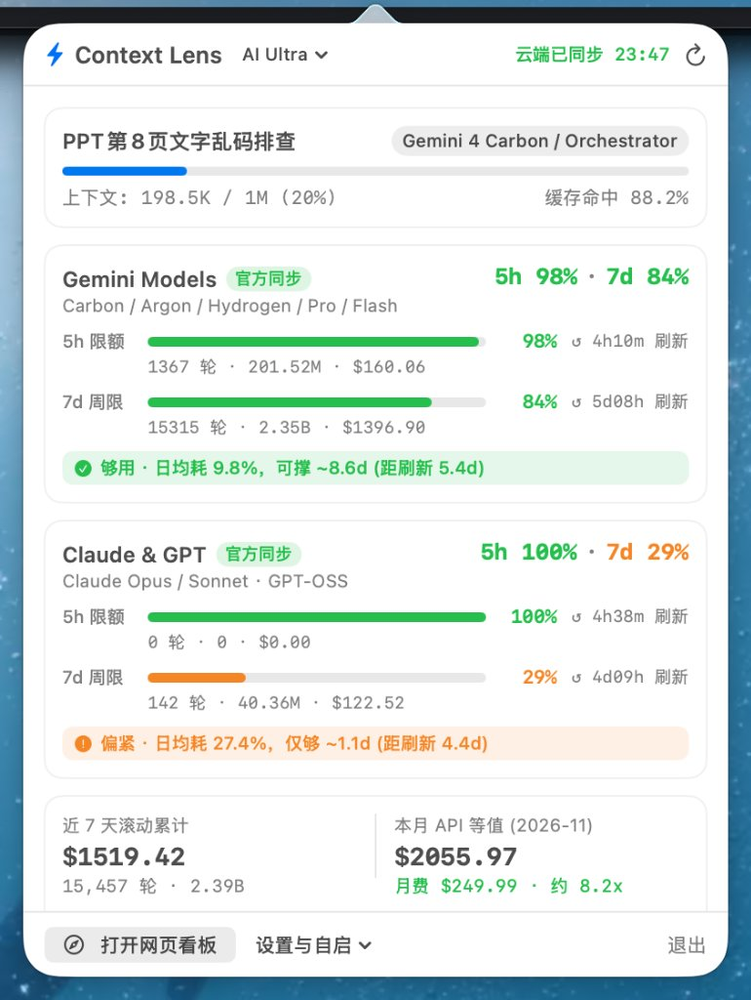
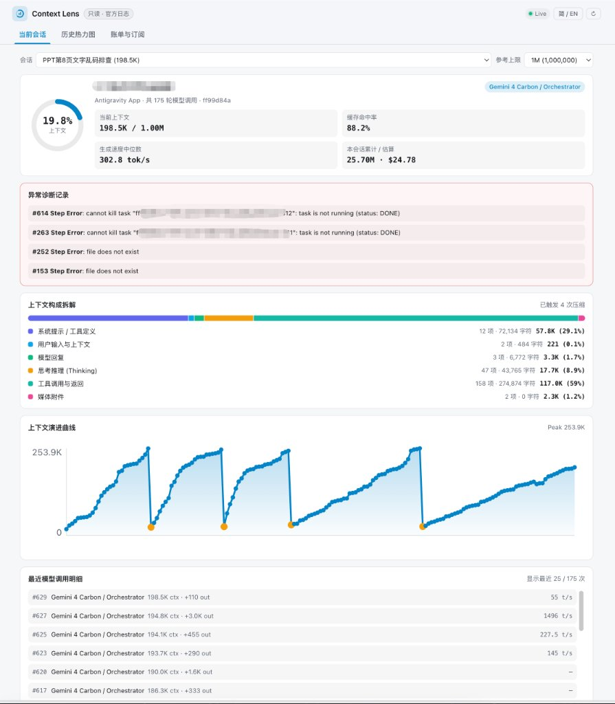
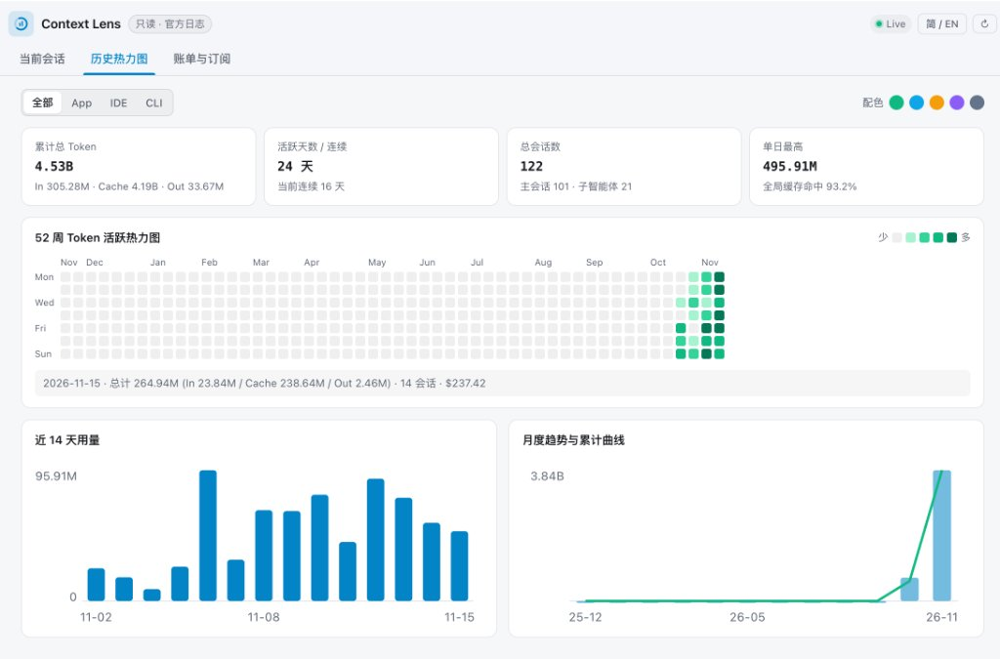
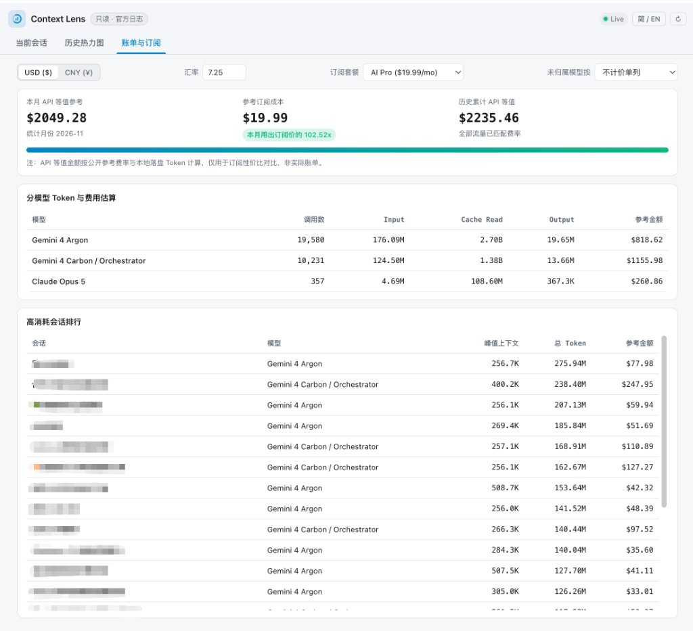

# Context Lens

> **100% Non-Invasive Observability & Quota Suite for Google Antigravity (`agy`)** — Native SwiftUI **macOS Menu Bar Quota Monitor** (5-hour & 7-day weekly limit reset countdowns + burn-rate runway, inspired by `CodexBar`), **Live 1M Context Window & Compaction Curve Analyzer**, **52-Week Token Usage Heatmap**, and **API Cost & Subscription ROI Estimator** (inspired by `ccusage`), built strictly on official Antigravity plugin specs and `agy` CLI hooks.

[简体中文](./README.md) · [English](./README.en.md) · [Troubleshooting](./docs/TROUBLESHOOTING.md)

[](https://github.com/rayeesoft/context-lens/actions/workflows/ci.yml)
[](https://github.com/rayeesoft/context-lens/actions/workflows/release.yml)
[](./LICENSE)
[](#requirements)
[](#requirements)

---

## Screenshots

<table>
  <tr>
    <td width="50%" align="center" valign="top">
      <a href="./docs/screenshots/menubar-quota.jpg"></a>
      <br />
      <strong>macOS Menu Bar Monitor (<code>ContextLensBar.app</code>)</strong><br />
      <sub>Official cloud-synced 5h &amp; 7d limits for <code>Gemini Models</code> and <code>Claude &amp; GPT</code>, exact refresh countdowns, 7d pacing runway, and monthly ROI</sub>
    </td>
    <td width="50%" align="center" valign="top">
      <a href="./docs/screenshots/dashboard-session.jpg"></a>
      <br />
      <strong>Live Session Context Inspector</strong><br />
      <sub>Server-verified 1M context occupancy, cache hit rate, step error diagnostics, 6-category context split, and auto-compaction sawtooth timeline</sub>
    </td>
  </tr>
  <tr>
    <td width="50%" align="center" valign="top">
      <a href="./docs/screenshots/dashboard-heatmap.jpg"></a>
      <br />
      <strong>52-Week Multi-Surface Heatmap</strong><br />
      <sub>Unifies Desktop App, IDE, and CLI sessions with 5 color themes, streak stats, 14-day bars, and cumulative monthly curves</sub>
    </td>
    <td width="50%" align="center" valign="top">
      <a href="./docs/screenshots/dashboard-billing.jpg"></a>
      <br />
      <strong>API Reference Cost &amp; Plan ROI</strong><br />
      <sub>Converts token usage to USD / CNY API list-price equivalents, measures AI Ultra / Pro payback multiplier, and ranks top-cost sessions</sub>
    </td>
  </tr>
</table>

---

## Why Context Lens?

| Capability | **Context Lens** | CLI-Only Log Trackers (e.g. `ccusage`) | Unofficial / Invasive Quota Scrapers |
| :--- | :---: | :---: | :---: |
| **Live Cloud `5h + 7d` Quotas & Reset Timers** | ✅ Official `agy` CLI sync | ❌ Local spend logs only | ⚠️ Often scrapes private ports or CSRF tokens |
| **Weekly Burn Rate & Runway Prediction** | ✅ Daily burn % vs. days until refresh | ❌ | ⚠️ Usually shows raw % without runway pacing |
| **Per-Session 6-Category Context & Compaction** | ✅ Server-verified tokens + compaction graph | ❌ Cross-session totals only | ❌ No in-session context anatomy |
| **52-Week Heatmap + API Cost & Plan ROI** | ✅ Multi-surface + 5 themes + ROI multiplier | ✅ Historical bills & heatmaps | ❌ No historical spend analytics |
| **Menu Bar App + Official Sidecar + Chat Skill** | ✅ Native SwiftUI + Sidecar + `/context-lens` | ❌ Terminal / static web only | ⚠️ Single surface only |
| **100% Official & Non-Invasive Compliance** | ✅ Zero `app.asar` patching, zero credential persistence | ✅ Read-only logs | ❌ Brittle across client updates or key rotations |

---

## Highlights

### 1. Native macOS Menu Bar Monitor (`ContextLensBar.app`)
- **Official Cloud Quota Sync via `agy` CLI**: Automatically syncs on launch and every 3 minutes (or immediately via `↻`) using Antigravity CLI's official `--settings statusLine` + `/usage` hooks, matching Antigravity's **Models & Usage** view:
  - **`Gemini Models`**: Shared pool across Carbon / Argon / Hydrogen / Pro / Flash (**5h Limit + 7d Weekly Limit**)
  - **`Claude & GPT`**: Shared pool across Claude Opus / Sonnet · GPT-OSS (**5h Limit + 7d Weekly Limit**)
- **7-Day Pacing & Runway Estimator**: Computes daily burn % and estimated runway vs. exact cloud refresh countdown (`够用` / `基本够用` / `偏紧` / `周限将尽`), seamlessly falling back to local rolling estimates when offline.
- **Zero-Config Proxy Support**: Automatically respects proxy env vars, macOS System Proxy (`scutil --proxy`), or an explicit proxy override saved in the popover UI.
- **Active Session Context & Auto-Start**: Displays current conversation context ratio (`1M` window), cache hit rate, 7d / monthly API reference cost, AI Credits memo, and one-click `LaunchAgent` login item toggle (menu bar only, no Dock icon).

### 2. Official Sidecar Auxiliary Pane & Standalone Dashboard
- **6-Category Context Breakdown**: Reads server-reported token counts (`input_tokens + cache_read_tokens`), cache hit rate, median output speed (tokens/s), category shares (System/Tools, User Prompts, Assistant Replies, Thinking, Tool Calls/Results, Media), and compaction timeline.
- **52-Week Activity Heatmap**: Aggregates Desktop App, IDE, and CLI sessions under `~/.gemini/` into a GitHub-style heatmap with 5 color themes, 14-day bars, and top sessions.
- **API Reference Cost Estimator**: Compares estimated API list-price equivalent spend against subscription plans (`Google AI Ultra`, `AI Pro`, `AI Plus`).

### 3. `/context-lens` Chat Skill
Invoke `/context-lens` inside any Antigravity chat to print an on-demand summary of the active conversation context and recent usage.

---

## Non-Invasive & Compliance Guarantees

- **Zero Client Modification**: Never unpacks or patches `app.asar`, preserves macOS code signatures, and survives client updates cleanly.
- **Zero Private/Undocumented Probing**: Never reads `language_server` private ports, CSRF tokens, or internal `.pbtxt` files.
- **Read-Only Telemetry & Credential Hygiene**: Only reads public `transcript.jsonl` logs and read-only `conversation_summaries.db`. Official quota sync strips `email` before caching to `~/.gemini/antigravity/plugin_data/context-lens/official-quota-cache.json`.

---

## Requirements

1. **Node.js `>= 22.5.0`** (uses built-in `node:sqlite`; zero external npm dependencies). Supported across Homebrew, `nvm`, `fnm`, `volta`, `mise`, and `asdf`.
2. **Antigravity + Official `agy` CLI** (for official cloud quota sync): Sign in once by running `agy` in Terminal.
3. **macOS `13.0+`** (for `ContextLensBar.app` only; building from source requires Xcode Command Line Tools via `xcode-select --install`, or download a prebuilt zip from Releases).

---

## Quick Start

### Option A: One-Command Install from Source (macOS / Linux)

```bash
git clone https://github.com/rayeesoft/context-lens.git
cd context-lens
bash install.sh
```

Useful flags:
- `bash install.sh --universal` — build Universal Binary (`arm64 + x86_64`) on macOS
- `bash install.sh --no-menubar` — install only the Antigravity plugin & Sidecar dashboard
- `bash install.sh --uninstall` — cleanly remove plugin, `LaunchAgent`, and `ContextLensBar.app` (preserves user data under `plugin_data/context-lens`)

### Option B: Prebuilt macOS Menu Bar App

1. Download `ContextLensBar-vX.Y.Z-macos-universal.zip` from [GitHub Releases](https://github.com/rayeesoft/context-lens/releases) and unzip it.
2. Move `ContextLensBar.app` into `~/Applications/` (or `/Applications/`).
3. Remove the quarantine attribute on first launch (ad-hoc signed open-source build):
   ```bash
   xattr -cr ~/Applications/ContextLensBar.app
   open -a ~/Applications/ContextLensBar.app
   ```
4. To also enable the Sidecar pane and `/context-lens` skill, install the plugin bundle:
   ```bash
   git clone https://github.com/rayeesoft/context-lens.git
   agy plugin install ./context-lens
   ```

---

## Verification & Development Commands

```bash
# Run full unit test suite
npm test

# Validate manifests, version consistency, and repository privacy hygiene
npm run validate

# Run official Antigravity strict plugin validation
agy plugin validate . --strict

# Run quota CLI snapshot & live cloud sync
npm run quota
npm run quota:sync

# Start standalone web dashboard at http://127.0.0.1:4799/
npm run dashboard
```

---

## Documentation & License

- Troubleshooting guide: [docs/TROUBLESHOOTING.md](./docs/TROUBLESHOOTING.md)
- Release history: [CHANGELOG.md](./CHANGELOG.md)
- License: [MIT](./LICENSE)
