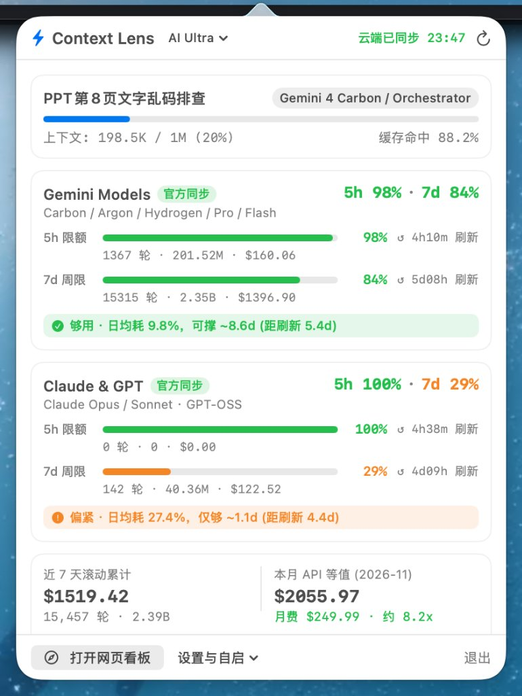
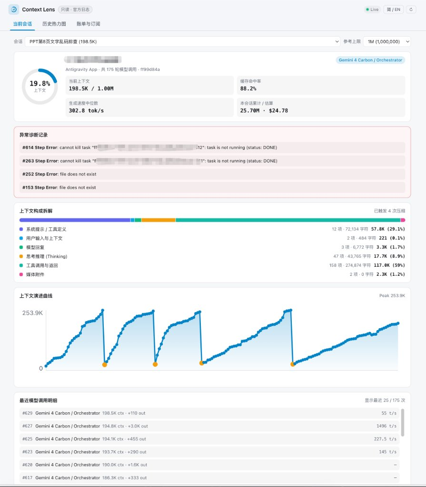
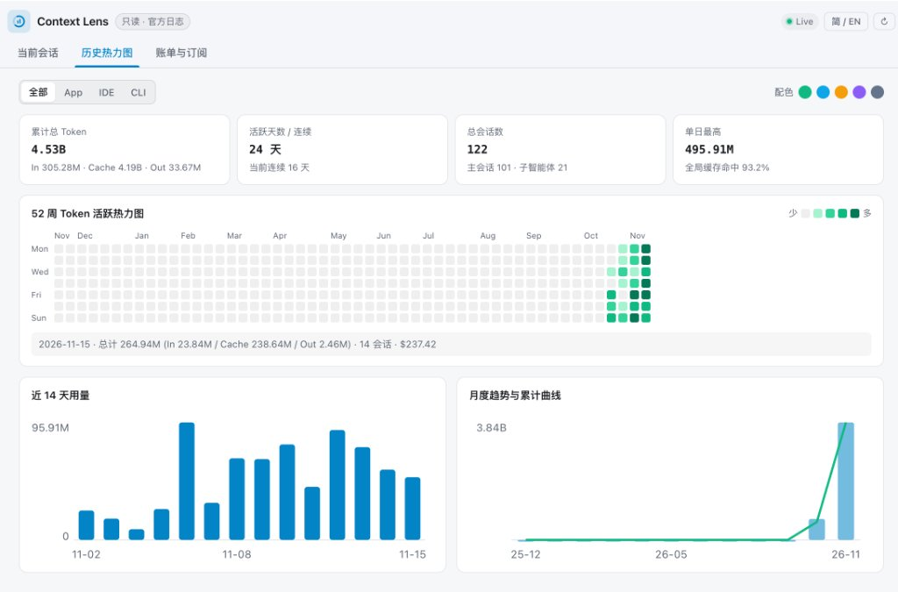
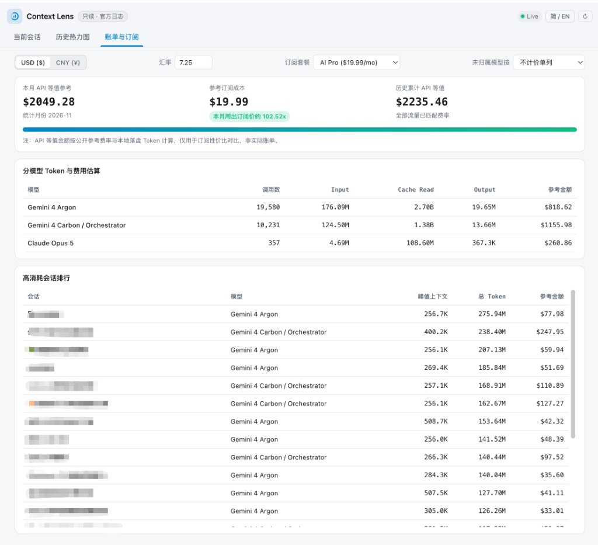

# Context Lens

> **100% 非侵入式 Google Antigravity (`agy`) 全能观测套件** — 集 **macOS 原生菜单栏配额监控 (Menu Bar Quota Monitor)**、**5h / 7d 周限额与重置倒计时 (5-Hour & Weekly Limit Reset Countdown)**、**1M 上下文窗口拆解与 Compaction 压缩曲线 (Context Window Breakdown)**、**52 周 Token 活跃热力图 (Token Usage Heatmap)** 与 **API 等值账单及 AI Ultra 订阅回本倍率 (Subscription ROI)** 于一体；融合 `CodexBar` 级的桌面菜单栏体验与 `ccusage` 级的本地账单热力图，严格基于 Antigravity 官方插件与 `agy` CLI 规范构建。

[简体中文](./README.md) · [English](./README.en.md) · [故障排查](./docs/TROUBLESHOOTING.md)

[](https://github.com/rayeesoft/context-lens/actions/workflows/ci.yml)
[](https://github.com/rayeesoft/context-lens/actions/workflows/release.yml)
[](./LICENSE)
[](#环境要求)
[](#环境要求)

---

## 界面预览 (Screenshots)

<table>
  <tr>
    <td width="50%" align="center" valign="top">
      <a href="./docs/screenshots/menubar-quota.jpg"></a>
      <br />
      <strong>macOS 菜单栏实时配额 (<code>ContextLensBar.app</code>)</strong><br />
      <sub><code>Gemini Models</code> 与 <code>Claude &amp; GPT</code> 官方同步 5h / 7d 余量、刷新倒计时、周节奏评估与月度订阅回本倍率</sub>
    </td>
    <td width="50%" align="center" valign="top">
      <a href="./docs/screenshots/dashboard-session.jpg"></a>
      <br />
      <strong>当前会话上下文透视 (Session Inspector)</strong><br />
      <sub>1M 上下文占用、缓存命中率、异常步骤诊断、6 类构成拆解与自动压缩（Compaction）演进曲线</sub>
    </td>
  </tr>
  <tr>
    <td width="50%" align="center" valign="top">
      <a href="./docs/screenshots/dashboard-heatmap.jpg"></a>
      <br />
      <strong>52 周全终端 Token 热力图 (Activity Heatmap)</strong><br />
      <sub>聚合 App / IDE / CLI 历史消耗、连续活跃天数、5 套配色主题、近 14 天趋势与月度累计曲线</sub>
    </td>
    <td width="50%" align="center" valign="top">
      <a href="./docs/screenshots/dashboard-billing.jpg"></a>
      <br />
      <strong>API 等值账单与订阅 ROI (Cost &amp; ROI)</strong><br />
      <sub>按公开模型单价估算 USD / CNY 账单，对比 AI Ultra / AI Pro 回本倍率并列出高消耗会话排行</sub>
    </td>
  </tr>
</table>

---

## 与同类工具对比 (Why Context Lens?)

| 核心维度 | **Context Lens** | 纯 CLI 账单统计类（如 `ccusage`） | 常规非官方配额插件 / 补丁工具 |
| :--- | :---: | :---: | :---: |
| **实时云端 `5h + 7d` 限额 & 刷新倒计时** | ✅ 官方 `agy` CLI 同步 | ❌ 仅本地估算无官方限额 | ⚠️ 常需逆向私有端口或 CSRF |
| **周消耗速率与可撑天数预测 (Runway)** | ✅ 日均耗比 vs 距刷新天数 | ❌ | ⚠️ 多数仅展示当前剩余百分比 |
| **单会话 `1M` 上下文 6 维拆解 & 压缩曲线** | ✅ 服务端验证 + 自动压缩锯齿图 | ❌ 仅按天/按项目汇总 | ❌ 无会话内部上下文可视化 |
| **52 周热力图 + API 等值账单 & 订阅 ROI** | ✅ 多端汇总 + 5 套配色 + ROI 倍率 | ✅ 历史账单/热力图 | ❌ 缺少历史消费复盘看板 |
| **原生 macOS 菜单栏 + Sidecar + 聊天技能** | ✅ SwiftUI 菜单栏 + Sidecar + `/context-lens` | ❌ 仅终端 / 网页 | ⚠️ 通常仅菜单栏或仅 IDE 侧栏 |
| **100% 官方合规（零补丁、零私有探测）** | ✅ 零修改客户端、升级不失效、不落盘凭证 | ✅ 仅读本地日志 | ❌ 改 `app.asar` 或探测私有 RPC 有合规与失效风险 |

---

## 核心特性

### 1. macOS 原生菜单栏助手（`ContextLensBar.app`）
- **官方云端双池限额精准同步**：通过 Google 官方 `agy` CLI 公开机制（`--settings statusLine` 与 `/usage`）自动（启动时 & 每 3 分钟）或手动（右上角 `↻`）拉取云端真实限额，与 Antigravity 内置 **Models & Usage** 页面完全对齐：
  - **`Gemini Models`**：Carbon / Argon / Hydrogen / Pro / Flash 共享池（**5h 限额 + 7d 周限**）
  - **`Claude & GPT`**：Claude Opus / Sonnet · GPT-OSS 共享池（**5h 限额 + 7d 周限**）
- **“够不够用”周消耗节奏评估**：结合官方 7d 剩余比例与精准刷新倒计时（`XdXXh`），实时计算日均消耗与预计可支撑天数（`够用` / `基本够用` / `偏紧` / `周限将尽`）。
- **无网络 / 未登录自动兜底**：若当前处于离线或未登录 CLI 状态，自动平滑回退至本地滚动窗口消费估算。
- **状态栏多模式显示 & 开机自启**：支持 `5h:XX% · 7d:XX%` 双窗简显、主池自动跟随、AI Credits 备忘与 `LaunchAgent` 开机自启（零 Dock 栏图标占用）。

### 2. 官方 Sidecar 侧边栏与独立网页看板
- **当前会话上下文拆解**：直接读取服务端回写的精确上下文占用（`input_tokens + cache_read_tokens`）、缓存命中率、输出速度中位数（tokens/s）、6 类构成占比（系统与工具、用户输入、模型回复、Thinking、工具调用、媒体）以及自动压缩前后曲线。
- **52 周全终端热力图**：自动聚合 Antigravity 桌面端 App、IDE 与 CLI 的历史日志，生成 GitHub 风格 52 周活跃热力图（5 套主题配色）、近 14 天趋势柱状图与高频会话排行。
- **API 等值账单与订阅回本倍率**：按公开列表参考单价估算本月与近 7 天等值费用，对比 `Google AI Ultra` / `AI Pro` / `AI Plus` 月费倍率。

### 3. 对话内 `/context-lens` 技能
在任意 Antigravity 对话中输入 `/context-lens`，直接生成精简的上下文构成与 Token 统计 Markdown 报告。

---

## 为什么是 100% 非侵入式与合规的？

- **零客户端补丁**：绝不解包或篡改 `app.asar`，不破坏 macOS 应用代码签名，不触发完整性校验警告，客户端升级后依然稳定可用。
- **零未公开私有接口**：绝不读取或探测桌面端内部 `language_server` 私有端口、CSRF Token 或私有 `.pbtxt` 状态文件。
- **官方合规数据通道**：
  - 本地会话统计：只读扫描 `~/.gemini/*/brain/` 下的公开 `transcript.jsonl` / `transcript_full.jsonl` 与只读打开 `conversation_summaries.db`；仅 `SessionStart` 钩子记录初始模型名称。
  - 官方限额同步：严格调用官方 `agy` 命令行并安全解析 `statusLine` JSON，缓存写入 `~/.gemini/antigravity/plugin_data/context-lens/official-quota-cache.json` 时**主动剔除 `email` 等账号敏感字段，绝不落盘任何凭证**。

---

## 使用入口一览

| 形态 | 适用平台 | 打开方式 | 核心用途 |
| :--- | :--- | :--- | :--- |
| **菜单栏助手** `ContextLensBar.app` | macOS 13+ | 点击菜单栏闪电图标 `⚡` | 随时瞄一眼 `5h / 7d` 官方剩余限额、刷新倒计时与周余量评估 |
| **Sidecar 辅助栏** | macOS / Linux / Windows | Antigravity 对话右上角 `+` → **Context Lens** | 在对话旁实时看当前上下文 6 类构成与压缩曲线 |
| **独立网页看板** | 全平台浏览器 | `npm run dashboard` 或菜单栏点击「打开网页看板」 | 大屏查看 52 周热力图、分模型消费与会话明细 |
| **对话技能** `/context-lens` | Antigravity 对话内 | 输入 `/context-lens` | 让 Agent 直接汇总当前会话和近期消费报告 |

---

## 环境要求

1. **Node.js `>= 22.5.0`**：使用了 Node 内置 `node:sqlite`，零 `npm install` 第三方依赖。推荐通过 `brew install node`、`nvm`、`fnm`、`volta` 或 `mise` 安装。
2. **Antigravity 与官方 `agy` CLI**（强烈推荐）：菜单栏自动同步官方云端配额依赖已登录的 `agy`（通常位于 `~/.local/bin/agy`）。安装后请在终端执行一次 `agy` 完成账号登录。
3. **macOS `13.0+`**（仅编译/运行 `ContextLensBar.app` 需要）：从源码编译需已安装 Xcode Command Line Tools（`xcode-select --install`）；也可直接从 GitHub Releases 下载预编译通用安装包。

---

## 快速开始

### 方式 A：源码克隆一键安装（推荐，含插件 + macOS 菜单栏 App）

```bash
git clone https://github.com/rayeesoft/context-lens.git
cd context-lens
bash install.sh
```

常用安装参数：
- `bash install.sh --universal`：编译 `arm64 + x86_64` 双架构通用菜单栏 App
- `bash install.sh --no-menubar`：仅安装 Antigravity 插件与 Sidecar（Linux / 不需要菜单栏时使用）
- `bash install.sh --uninstall`：一键退出菜单栏、清理开机自启并卸载插件（默认保留用户本地数据目录以防误删配置）

### 方式 B：直接下载预编译菜单栏 App（macOS）

1. 前往本仓库 [Releases](https://github.com/rayeesoft/context-lens/releases) 下载 `ContextLensBar-vX.Y.Z-macos-universal.zip` 并解压。
2. 将 `ContextLensBar.app` 拖入 `~/Applications/`（或 `/Applications/`）。
3. 由于个人开源构建使用 ad-hoc 本地签名、未经过 Apple 公证，首次打开如提示“无法验证开发者”，在终端执行一次：
   ```bash
   xattr -cr ~/Applications/ContextLensBar.app
   open -a ~/Applications/ContextLensBar.app
   ```
4. 若同时需要在 IDE / 对话内使用 Sidecar 面板与 `/context-lens` 技能，可执行：
   ```bash
   git clone https://github.com/rayeesoft/context-lens.git
   agy plugin install ./context-lens
   ```

---

## 启用插件与云端同步配置

### 1. 确保 `agy` CLI 已登录
在终端运行一次：
```bash
agy
```
确认右上角已显示你的账号（与 Antigravity 桌面端登录同一个账号）后输入 `/exit` 退出即可。此后 `ContextLensBar.app` 会全自动在后台通过 `agy` 刷新配额。

### 2. 网络代理说明（中国大陆等需要代理的环境）
后台调用 `agy` 连接 Google 服务时，代理优先级如下：
1. `ContextLensBar.app` 内「**设置与自启 → 同步代理设置**」保存的地址（支持 `http://127.0.0.1:7890`、`socks5://127.0.0.1:1086` 或简写 `:7890`）
2. 命令行环境变量（`HTTPS_PROXY` / `ALL_PROXY` 等）
3. macOS 系统代理设置（自动读取 `scutil --proxy`）

> 若遇到同步超时，可在系统代理开启后点击右上角 `↻`，或在菜单栏下拉「**设置与自启 → 同步代理设置**」直接填入本地代理端口并点击「保存并同步」。

### 3. 开启 Sidecar 辅助栏（可选）
在 Antigravity 中进入 **Customizations → Installed → Context Lens**，开启 Sidecar 开关，即可在聊天右上角 `+` 菜单看到 **Context Lens** 面板入口。

---

## 开发与校验命令

仓库零外部依赖，所有测试与校验均可直接运行：

```bash
# 运行全部单元测试（Analyzer + Quota + CLI 同步解析）
npm test

# 校验 manifest 版本一致性、文件引用完整性及隐私/敏感信息零泄露扫描
npm run validate

# 使用 Antigravity 官方 CLI 严格校验插件规范
agy plugin validate . --strict

# 手动测试一次本地配额汇总与官方云端同步
npm run quota
npm run quota:sync

# 仅编译 Universal macOS 菜单栏 App（输出至 ~/Applications/ContextLensBar.app）
npm run build:menubar:universal
```

---

## 项目结构

```text
context-lens/
├── .github/workflows/          # GitHub Actions CI（单测+校验+macOS编译）与自动 Release
├── assets/logo.svg             # 插件图标
├── docs/TROUBLESHOOTING.md     # 常见问题与报错排查手册
├── menubar/
│   ├── ContextLensBar.swift    # 原生 macOS 菜单栏 App (SwiftUI + AppKit)
│   ├── Info.plist              # Bundle 清单与版本号
│   └── build.sh                # 编译、Universal 打包与 ad-hoc 签名脚本
├── scripts/
│   ├── analyzer.mjs            # 会话上下文拆解、52 周热力图与 API 单价估算
│   ├── cli-quota-sync.mjs      # 官方 agy CLI PTY 云端限额同步引擎
│   ├── quota.mjs               # 双池限额快照与 7d 消耗节奏评估
│   ├── report.mjs              # /context-lens 技能输出入口
│   ├── session-start-hook.mjs  # SessionStart 初始模型记录钩子
│   ├── validate-repo.mjs       # 版本一致性与开源隐私脱敏校验脚本
│   ├── analyzer.test.mjs
│   └── quota.test.mjs
├── sidecars/dashboard/         # 官方 Sidecar Web UI 与独立 HTTP 服务器
├── skills/context-lens/        # /context-lens Skill 定义
├── CHANGELOG.md
├── hooks.json                  # Antigravity Hook 清单
├── install.sh                  # 一键安装 / 卸载脚本
├── LICENSE                     # MIT License
├── package.json
└── plugin.json                 # Antigravity 插件核心清单
```

---

## 常见问题

更多关于 `agy` 登录状态、代理连接超时、`Node.js` 版本过低、macOS 钥匙串授权或首次打开安全提示的处理方法，请参阅 [故障排查指南](./docs/TROUBLESHOOTING.md)。

## 开源协议

基于 [MIT License](./LICENSE) 开源。如果你觉得有用，欢迎 Star 或提交 Issue / Pull Request！
